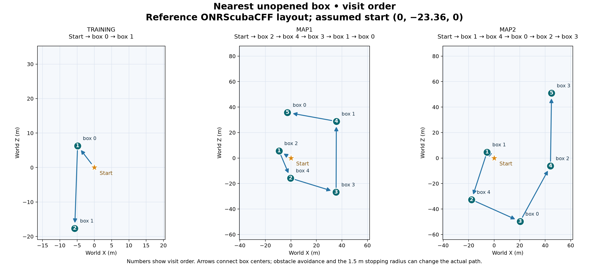

# ONR Expert Scout

An AUV scout controller for the ONR Unity simulator. It visits the nearest
unopened box using live simulator coordinates, waits for the human-controlled
diver to open it, then selects the next nearest unopened box. YOLO confidence
is reported independently through three keyboard shortcuts.

```bat
python main.py --role scout-expert --pid 0
```

## Project layout

```text
ONR-expert-scout/
├── main.py                         Command-line entry point
├── expert_scout/                   Detection, navigation, telemetry and controls
├── modules/                        Original ONR controller modules
├── configs/
│   ├── expert.json                 Runtime settings
│   ├── maps.json                   Grid-search boundaries
│   └── simulator.json              Simulator compatibility record
├── checkpoints/
│   └── yolo_box_detector_cvat_yolov8n_e20_best.pt
├── requirements-expert.txt         Expert scout dependencies
├── requirements.txt                Original controller dependencies
└── tests/                          Controller and compatibility tests
```

The Unity build, virtual environment and run logs are local files excluded from
Git. The default simulator location is `ONR_Scuba_Pilot/` in the repository root;
a build located elsewhere is also supported.

## Environment setup

Use Windows 10 or 11, Python 3.11, Git and the supplied Unity build. The dependency
file installs PyTorch 2.2.0 with CUDA 12.1 and the packages needed for screen
capture, YOLO detection and keyboard control. The trained YOLO checkpoint is
included in this repository.

Clone the repository and install the expert scout environment from **Windows
Command Prompt**:

```bat
git clone https://github.com/mazdarani/ONR-expert-scout.git
cd ONR-expert-scout
py -3.11 -m venv .venv
.venv\Scripts\activate.bat
python -m pip install --upgrade pip
python -m pip install -r requirements-expert.txt
```

Access to the private repository requires GitHub authentication. For an existing
checkout, run `git pull --ff-only` before updating the dependencies. In PowerShell,
activate the same environment with `.\.venv\Scripts\Activate.ps1`.

### Simulator files

Extract the complete Unity build, preserving all files supplied with the
executable. A typical local installation is:

```text
ONR-expert-scout/
├── .venv/
├── ONR_Scuba_Pilot/
│   ├── ONR Scuba.exe
│   ├── ONR Scuba_Data/
│   ├── UnityPlayer.dll
│   └── OutputData/                 Participant telemetry written by Unity
└── logs/                           Created by Python during a run
```

`OutputData` must be writable. Start Unity before Python: on Windows, the
controller finds the running `ONR Scuba.exe` and reads telemetry beside that
executable. If no running build is found, it uses the directory configured in
`configs/expert.json`.

To select a particular build, pass the folder containing its executable:

```bat
python main.py --role scout-expert --pid 0 --sim-dir "C:\Simulators\ONR_Scuba_Pilot"
```

## Run an experiment

1. Launch `ONR Scuba.exe`, choose a participant ID and start a scenario.
2. Place the AUV camera on monitor **2** and the diver view on the other display.
3. Activate the Python environment and launch the controller with the same ID:

   ```bat
   .venv\Scripts\activate.bat
   python main.py --role scout-expert --pid 0
   ```

4. Return focus to the Unity window so it receives the generated keyboard input.

The terminal prints the telemetry location, selected map and controller state.
Detection feedback includes the numeric score, confidence category and key sent:

```text
YOLO: confidence=0.800, level=medium, key=SHIFT+2, sent=True
```

There is **no default time limit**. Stop Python with `Ctrl+C`, or set a limit with
`--duration-sec`. Menus, SAGAT, oxygen depletion and stale telemetry suspend AUV
movement while Python remains running. Starting another scenario with the same
participant ID resets the route, target and collected-box history.

### Simulator shortcuts

| Action | Shortcut |
| --- | --- |
| Open the Debug Panel | `Ctrl+Shift+X` |
| Get mouse control after opening the Debug Panel | `Shift+Spacebar` |
| Collect a box as the diver | `F` |
| Open the box communication panel | `0` |
| Close the box communication panel | `9` |

The Debug Panel shortcuts are operated manually in Unity. Python controls the
AUV through `I/K`, `J/L`, `U/O`, `N/M` and the light-flash key `P`.

### Launch options

| Option | Purpose |
| --- | --- |
| `--pid 0` | Participant ID; must match Unity. Required. |
| `--monitor-index 1` | Capture another AUV display; default is `2`. |
| `--sim-dir "C:\Simulators\ONR_Scuba_Pilot"` | Select the simulator directory explicitly. |
| `--state-file "C:\path\ParticipantData_PID_0.json"` | Read one specified telemetry file. |
| `--seed 1234` | Use a fixed grid randomization seed in optional grid mode. |
| `--duration-sec 600` | Stop after ten minutes; default is unlimited. |
| `--dry-run` | Log requested actions without sending keyboard input. |
| `--map map1` | Override automatic map selection with `training`, `map1` or `map2`. |
| `--config "C:\path\expert.json"` | Load an alternative runtime configuration. |

Run `python main.py --role scout-expert --help` for the command-line reference.
Relative paths inside the configuration are resolved from the repository root.

## Controller behavior

The default `route_mode` in `configs/expert.json` is `nearest`. Selection uses
3D distance from the current AUV position to every unopened box in `boxTimeList`.
The closest box is selected first, with box ID breaking equal-distance ties.
That target remains fixed during approach and waiting; a different camera
observation does not redirect the AUV. After collection and the dwell, the next
choice uses the AUV's actual position. This is a nearest-neighbor route, rather
than a globally shortest tour. YOLO is used for confidence feedback and is not
required to trigger travel.

During travel, the scout **stops beyond 5 m from the diver** and resumes once the
diver is **within 3 m**. Missing diver position also stops travel. This applies
to box approaches as well as the optional grid search. The AUV turns toward its
target before moving forward, while retaining the existing obstacle rules.

At **1.5 m from its target**, the AUV releases movement and waits for that specific
box to be opened. It stays there if the diver swims away, the camera loses the
box, or the box temporarily disappears from telemetry. It does not follow the
diver away from an unopened target. Confirmed collection triggers three light
flashes and a **10-second dwell**, followed by the next nearest unopened box.
If the diver is still too far away, travel remains paused. When all boxes have
been opened, the AUV stops.

Only confirmed opened IDs are excluded from later approaches. A collection count
increase without an identifiable box holds movement until identity is resolved.
The controller never presses the diver's collection key.

Set `route_mode` to `grid` to use the earlier randomized grid with YOLO-triggered
approach. Its waypoint jitter is 2.5 m and depth jitter is 1.5 m. Both modes use
the same diver-distance limits and collection wait. Distances and dwell settings
are configurable in `configs/expert.json`. This version does not load OpenVLA.

## Confidence feedback

The controller sends a confidence shortcut whenever its latest camera result
contains a box detection at or above the YOLO threshold. If several boxes are
visible, the highest-confidence box detection selects the category. Sending is
independent of target matching, distance, movement state and telemetry freshness;
keys may repeat even when the category or captured frame has not changed.

| YOLO score | Category | Shortcut |
| --- | --- | --- |
| 0.25 to below 0.72 | Low | `Shift+1` |
| 0.72 to below 0.82 | Medium | `Shift+2` |
| 0.82 to 1.00 | High | `Shift+3` |

The digits are the **top-row number keys**, not the numpad. Python presses Shift
before the digit and releases it afterward. The Unity confidence receiver must
use the same three combinations; plain-number camera bindings must not also
handle these shortcuts.

Thresholds are configured through `detector_confidence`, `medium_confidence` and
`high_confidence` in `configs/expert.json`. The defaults reflect the observed score
distribution of 5,202 detection frames from six August 28 runs: the 33rd and 67th
percentiles were 0.722 and 0.819. Low, medium and high describe relative detector
scores, rather than calibrated probabilities of correctness. Recheck their
distribution when changing the detector, lighting or camera settings.

The keyboard interface carries the category. The exact numeric YOLO score is
printed and saved in the run logs. `sent=True` records a successful key press;
it does not confirm that Unity displayed the corresponding feedback. Box identity
and collected-ID filtering belong to navigation; confidence signaling uses the
visible detections independently.

## Telemetry and map compatibility

Telemetry comes from `OutputData/ParticipantData_PID_<id>.json` or numbered
`ParticipantData_PID_<id>_COPY_<n>.json` files. The reader selects the newest file
for the exact participant ID and retains the last complete snapshot during
partial writes. Movement requires the `searching` state, a complete AUV pose and
telemetry no more than one second old.

Target positions are read from the current `boxTimeList`; the controller does
not assume a fixed number of boxes. Collection is confirmed using `boxesFound`
and a box's `findTime` remaining fixed for at least 0.5 seconds while searching
time advances. Repeated snapshots and pauses do not count as collection.
Ambiguous evidence keeps the AUV waiting. Explicit `collectedBoxIds`, when
provided by the simulator, are accepted directly.

The map is selected from telemetry `mapType` or `mapString`. Grid profiles in
`configs/maps.json` use the simulator's constraint-volume bounds with 2 m boundary
clearance. X/Z are world coordinates, Y is vertical and yaw is in degrees.

| Map | Search X (m) | Search Z (m) |
| --- | --- | --- |
| `training` | −13.509 to 17.471 | −17.915 to 32.255 |
| `map1` / `map2` | −37.319 to 58.681 | −61.030 to 84.970 |

Unknown maps hold movement until a supported map or explicit override is
available. A new map requires a supported identifier and matching search-area
profile. Map changes and session restarts clear route and collection history
because box IDs can be reused. Camera frames captured before a map switch are
excluded from navigation matching.

## Run outputs and troubleshooting

Each launch creates `logs/expert/pid_<id>/<episode>/`:

| File | Contents |
| --- | --- |
| `config.json` | Runtime settings, route seed, simulator path and optional duration. |
| `actions.jsonl` | Controller decisions, targets, collected IDs, actuation and confidence feedback. |
| `status.json` | Latest controller state, map bounds, telemetry diagnostics and confidence feedback. |

`confidence_feedback` records the YOLO score, category, key, sent status and skip
reason in both action and status logs.

| Symptom | Check |
| --- | --- |
| `telemetry_wait` | Read the accompanying message for the selected path and missing or stale data. Match participant IDs and enter a running scenario. |
| Wrong telemetry folder | Start Unity before Python, or provide `--sim-dir` pointing to the launched executable's folder. |
| `waiting_for_map` | Check the telemetry map identifier and configured search profile. |
| Grid moves but YOLO does not detect boxes | Check the AUV monitor index and checkpoint path in `configs/expert.json`. |
| Commands reach the terminal or AUV does not respond | Return focus to the Unity window. |
| Keys are logged but confidence feedback does not appear | Check the Unity receiver bindings against the three shortcuts above. |

## Tests and source

Run the automated checks from the activated environment:

```bat
python -m pip install pytest
python -m pytest -q
```

Tests cover navigation, collection tracking, telemetry, map selection and
confidence key handling. Live movement, detection performance and Unity feedback
should also be checked on the simulator computer before an experiment.

The initial commit preserves the original ONR controller at
`397c50b1dbf99a28ef55891e4c586ad91e07cebd`. The inherited `modules/` and
`requirements.txt` remain unchanged. `expert_scout/` implements the added mode;
`main.py` selects it while retaining the original `scout` and `companion` roles.

## Route preview



The [PDF](figures/scout_routes.pdf) and [route data](figures/scout_routes.json)
show training, map1 and map2 using the reference ONRScubaCFF positions in the
test fixtures and an assumed start at `(0, -23.36, 0)`. These are visit-order
previews, not verified layouts for a different simulator build. The controller
uses live telemetry rather than these fixtures. The actual order may change
with the starting pose, collection position or layout; arrows do not represent
an obstacle-free path.
